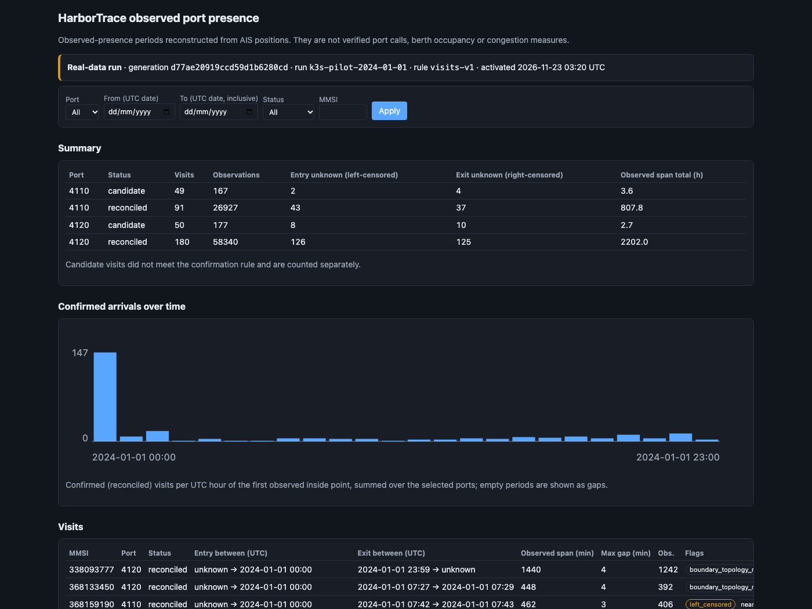

# HarborTrace on k3s

A single-node Kubernetes deployment of the whole pipeline: k3s runs MongoDB, Kafka, the dashboard and every Spark job (driver and executors as pods, submitted with `spark-submit --master k8s://`); HDFS runs natively on the same node with two DataNodes. Everything below starts from an empty machine and was run end to end on 23 November 2026 (results at the end).

```text
node: WSL2 Ubuntu 24.04 (Windows) or an Ubuntu VM (macOS: Lima)
├── native   HDFS NameNode 127.0.0.1:9000 + DataNodes :9866, :9876 (replication 2)
└── k3s      namespace harbortrace
     ├── mongodb-0      MongoDB 7, authentication on      127.0.0.1:30017 | mongodb.harbortrace.svc:27017
     ├── kafka-0        Kafka 4.1.2, KRaft                127.0.0.1:30092 | kafka.harbortrace.svc:9092
     ├── dashboard      read-only MongoDB user            127.0.0.1:30050
     └── Spark pods     driver + executors per job (hostNetwork: reach HDFS and Kafka at 127.0.0.1)
```

Only official images are used (`mongo:7.0.48`, `apache/kafka:4.1.2`, `python:3.12-slim-bookworm`, `apache/spark:3.5.7-scala2.12-java17-python3-ubuntu`); no project image is built. Pods read the checkout through a `hostPath` mount.

## 1. The node

**Windows (WSL2).** Ubuntu 24.04 with systemd: add the following to `/etc/wsl.conf`, then run `wsl --shutdown` in PowerShell and reopen Ubuntu.

```ini
[boot]
systemd=true
```

**macOS.** An Ubuntu VM with [Lima](https://lima-vm.io) (`brew install lima`), with the folder holding the checkout mounted read-only:

```bash
limactl start --name=hbt --cpus=6 --memory=12 --disk=60 --vm-type=vz \
  --set '.mounts=[{"location":"~/Documents/HUST_BIGDATA","writable":false}]' template://ubuntu-24.04
limactl shell hbt
```

Then, on the node (both cases), clone the repository inside the Linux file system and install the tools:

```bash
sudo apt-get update && sudo apt-get install -y openjdk-17-jdk-headless python3.12-venv git curl
git clone https://github.com/nxk176/big_data_group_15.git && cd big_data_group_15
python3 -m venv .venv
.venv/bin/pip install -r requirements-engine.txt -r requirements-serving.txt -r requirements-data.txt
```

Allow at least 4 CPUs and 8 GB of memory for the node (the run below used 6 CPUs and 12 GB).

## 2. k3s

```bash
bash deploy/k3s/install-k3s.sh        # k3s v1.37.2+k3s1, needs sudo; copies the kubeconfig to ~/.kube/config
kubectl get nodes                     # one node, Ready
```

## 3. HDFS on the node

As in the [services quickstart](services_quickstart.md):

```bash
bash deploy/native/hdfs-install.sh
HARBORTRACE_DATANODES=2 bash deploy/native/hdfs-start.sh --init-empty    # --init-empty on the first start only
bash deploy/native/hdfs-smoke.sh                                         # live_datanodes=2
```

## 4. MongoDB, Kafka and the dashboard

```bash
bash deploy/k3s/deploy.sh
```

The script creates the `harbortrace` namespace, generates passwords once into `data/k3s/credentials.env` (mode 600, never committed), stores them in the `mongodb-credentials` Secret, applies `deploy/k3s/manifests/` and waits for the three workloads. MongoDB and Kafka keep their data in k3s `local-path` volumes, so redeploying keeps it. Load the connection settings into a shell with:

```bash
set -a; source data/k3s/credentials.env; set +a
```

| MongoDB user | Rights | Used by |
|---|---|---|
| `admin` (database `admin`) | root | administration only |
| `harbortrace_writer` | `readWrite` on `harbortrace` | `serving_import.py` (import, apply updates): `$HARBORTRACE_MONGO_URI` |
| `harbortrace_reader` | `read` on `harbortrace` | the dashboard; analytics reads: `$HARBORTRACE_MONGO_READER_URI` |

To give an analyst a separate read account, open an interactive MongoDB shell in the pod.

```bash
kubectl -n harbortrace exec -it mongodb-0 -- mongosh --quiet
```

```javascript
db.getSiblingDB("admin").auth(process.env.MONGO_INITDB_ROOT_USERNAME, process.env.MONGO_INITDB_ROOT_PASSWORD)
const app = db.getSiblingDB(process.env.HARBORTRACE_DATABASE)
app.createUser({user: "analytics", pwd: passwordPrompt(), roles: ["read"]})
```

MongoDB creates the initial accounts on first boot with an empty volume. On redeployment the script checks the local credential file against the existing Secret. Keep a protected copy of the credential file for that volume.

**Dashboard in a browser.** On the node, `http://127.0.0.1:30050/`. From the Windows or macOS side, forward a port first (node ports are not forwarded out of WSL or the VM):

```bash
kubectl -n harbortrace port-forward svc/dashboard 8050:8050    # then http://localhost:8050/
```

### Check database access

The writer builds indexes and publishes generations. The dashboard receives the database name and reader URI. Its pod mounts the dashboard code and dependencies, and runs without a Kubernetes service account token. A host dashboard also requires `HARBORTRACE_MONGO_READER_URI` when selecting its connection from the environment. Supply just the database name and reader URI to that process. A writer URI alone makes it exit before it opens the HTTP port.

After publishing a generation, load the node connection settings from section 4 and run the access tests. They compare the deployed HTTP visit count with the active generation returned by the status CLI. They also check both database roles and exercise five operations MongoDB must refuse.

```bash
HARBORTRACE_TEST_K3S_ACCESS=1 PYTHONPATH=src:. .venv/bin/python -m pytest -q tests/integration/test_k3s_mongo_access.py
```

### Back up and restore MongoDB

Select the intended cluster with `kubectl config current-context`. Pause serving imports, updates and generation changes for the duration of the dump. This single MongoDB instance has no replica-set oplog for a point-in-time dump across collections. Dashboard reads can continue.

Run these commands from the checkout on a machine with Python 3 and permission to exec into `harbortrace/mongodb-0`. The Mongo image supplies the database tools. Choose a new backup directory on storage independent of the node and retain both files together.

```bash
BACKUP=/mnt/backups/harbortrace-$(date -u +%Y%m%dT%H%M%SZ)
python3 deploy/k3s/mongo-backup.py dump "$BACKUP"
python3 deploy/k3s/mongo-backup.py restore "$BACKUP"
```

The dump uses the read account and writes a gzip-compressed BSON archive and a mode-600 manifest in a mode-700 directory. Each collection must have the same document count, content hash and indexes immediately before and after the dump. A missing manifest identifies an incomplete backup. The archive contains application data. Store it on access-controlled, encrypted backup storage and retain the deployment credentials separately.

The restore checks the archive SHA-256 before writing, then uses the destination pod's administrator to restore into a newly generated `harbortrace_restore_*` database. It prints the database name and returns success only if every collection, index definition, collection option and active generation matches the source manifest. Each document contributes canonical Extended JSON to its collection's SHA-256 in `_id` order. The live dashboard keeps its original database. For a planned switch, provision accounts scoped to the verified recovery database and configure the clients to use that database and its authentication source. [MongoDB dump options](https://www.mongodb.com/docs/database-tools/mongodump/) · [MongoDB restore options](https://www.mongodb.com/docs/database-tools/mongorestore/)

#### Recovery drill on 23 November 2026

A disposable single-node k3s v1.37.2+k3s1 cluster ran the checked-in MongoDB 7.0.48 and dashboard manifests. The writer imported the complete 1 January 2024 all-port batch (20,487 visits). For provisional data it imported just the first two completed engine directories, batches 0 and 1, with 6,696 updates. The restore used MongoDB Database Tools 100.20.1.

| Collection | Source documents | Recovery database before restore | After restore |
|---|---:|---:|---:|
| visits | 20,487 | 0 | 20,487 |
| aggregates | 2,605 | 0 | 2,605 |
| provisional_visits | 6,755 | 0 | 6,755 |
| provisional_cohorts | 6,696 | 0 | 6,696 |
| audit_log | 3 | 0 | 3 |
| leases | 2 | 0 | 2 |
| update_imports | 2 | 0 | 2 |
| generations | 1 | 0 | 1 |
| serving_state | 1 | 0 | 1 |
| **Total** | **36,552** | **0** | **36,552** |

All nine content hashes and all 14 index definitions matched. The visits SHA-256 was `791ecca7ae18953c6b70442a882d10732944626c6ef789245cb7a711a151645f` in both databases. Replacing the MongoDB pod on the same PVC preserved the full source snapshot. A deliberately damaged archive failed verification before the tool contacted the cluster.

The dashboard and status CLI reported 20,487 visits for generation `32f38bd3be35d5b370eda4e1`. MongoDB returned code 13 for a row update, index creation and collection creation by the reader, a writer query against `admin.system.users`, and an anonymous read. Deploying with a missing or mismatched local credential file stopped before changing the existing Secret.

## 5. Spark jobs on Kubernetes

Once, install the Python packages the jobs import for the Spark image's Python 3.10:

```bash
bash deploy/k3s/spark-python-deps.sh     # a Job writes them to /var/lib/harbortrace/spark-python (sudo once)
```

Then any project script that accepts `--master submit` runs as a Kubernetes application (`spark-submit` in cluster mode, waiting for the result):

```bash
deploy/k3s/spark-submit.sh <script> [arguments]       # env: SPARK_EXECUTORS (2), SPARK_EXECUTOR_CORES (1),
                                                      # SPARK_EXECUTOR_MEMORY (2g), SPARK_DRIVER_MEMORY (2g), SPARK_PACKAGES
kubectl -n harbortrace get pods -l app=harbortrace-spark          # driver and executor pods
kubectl -n harbortrace logs <driver pod>                          # the script's output
```

**On WSL2.** Three differences found on the demo laptop (Windows 11, WSL2 with `networkingMode=mirrored` in `.wslconfig`):

- *Pods on the pod network may not reach the internet.* With mirrored networking, outgoing IPv6 from a pod fails (`Network is unreachable`) and IPv4 connections time out intermittently, so the `spark-python-deps` Job retries forever. The Spark pods themselves use `hostNetwork` and are not affected. Install the same packages from the node instead, as wheels for the image's Python 3.10:

  ```bash
  sudo mkdir -p /var/lib/harbortrace/spark-python && sudo chown "$(id -u):$(id -g)" /var/lib/harbortrace/spark-python
  .venv/bin/python -m pip install --target /var/lib/harbortrace/spark-python --only-binary=:all: \
    --python-version 3.10 --implementation cp --platform manylinux2014_x86_64 --platform manylinux_2_28_x86_64 \
    pyarrow==17.0.0 shapely==2.0.6 numpy==2.1.3 pandas==2.2.3 requests==2.32.3 pymongo==4.10.1
  ```

- *A virtual environment outside the checkout.* `spark-submit.sh` expects `.venv/` in the checkout; with another one, set `SPARK_SUBMIT=<venv>/bin/spark-submit` and `SPARK_HOME` to that venv's `pyspark` directory.
- *Package jars in the checkout.* With `SPARK_PACKAGES`, the driver pod fetches the resolved jars (Kafka source, about 11 files) into its working directory, which is the checkout root. Delete the `*.jar` files there after the run and never stage them. This happens on any node, not only WSL.
- *Inputs inside the checkout.* Pods mount only the checkout, so source files on a Windows drive (`/mnt/e/...`) must be copied under `data/` first, and output paths read by executors should be absolute (executors work in `/tmp`).

### The end-to-end pipeline

Put a NOAA day and the USACE boundaries under `data/source/` and `data/boundaries/` (see the [week-five guide](week05_ingestion.md), `--download-pilot`), then:

```bash
set -a; source data/k3s/credentials.env; set +a
CANONICAL=hdfs://127.0.0.1:9000/harbortrace/canonical/two-port-2024-01-01

# 1. Preparation on Spark pods -> day-partitioned canonical data on HDFS, two replicas
SPARK_EXECUTOR_CORES=2 deploy/k3s/spark-submit.sh scripts/data_storage.py spark-prepare \
  --source data/source/ais-2024-01-01.parquet --ports 4120 4110 --output $CANONICAL --replication 2 --partitions 8
# 2. Batch engine on Spark pods -> completed-batch artifact
SPARK_EXECUTOR_CORES=2 deploy/k3s/spark-submit.sh scripts/engine_batch.py --real --run-id pilot-2024-01-01 \
  --ports 4120 4110 --input $CANONICAL --output data/engine/pilot-2024-01-01 --partitions 4
# 3. Publish into MongoDB (writer user); the dashboard shows the generation
PYTHONPATH=src .venv/bin/python scripts/serving_import.py --database $HARBORTRACE_DATABASE import data/engine/pilot-2024-01-01
# 4. Replay into Kafka on k3s, sent/received accounting
source deploy/native/env.sh && mkdir -p data/canonical-copy
$HADOOP_HOME/bin/hdfs dfs -get $CANONICAL data/canonical-copy/        # the day partitions and _manifest.json
PYTHONPATH=src .venv/bin/python scripts/data_storage.py replay-files --canonical data/canonical-copy/two-port-2024-01-01 \
  --run-id replay-2024-01-01 --duplicates 500
PYTHONPATH=src .venv/bin/python scripts/data_storage.py kafka-publish --input data/replay/replay-2024-01-01 \
  --bootstrap $HARBORTRACE_KAFKA_BOOTSTRAP --topic harbortrace.replay-2024-01-01
# 5. Streaming engine on Spark pods, reading Kafka
SPARK_PACKAGES=org.apache.spark:spark-sql-kafka-0-10_2.12:3.5.7 SPARK_EXECUTOR_CORES=2 deploy/k3s/spark-submit.sh \
  scripts/engine_stream.py --source kafka:harbortrace.replay-2024-01-01 --kafka-bootstrap $HARBORTRACE_KAFKA_BOOTSTRAP \
  --output data/stream/replay-2024-01-01 --stream-id replay-2024-01-01 --ports 4120 4110 --max-per-trigger 5000 \
  --compare-artifact data/engine/pilot-2024-01-01
# 6. Provisional updates into MongoDB; a second run applies nothing again
PYTHONPATH=src .venv/bin/python scripts/serving_import.py --database $HARBORTRACE_DATABASE apply-directory data/stream/replay-2024-01-01
```

`serving_import.py` reads `HARBORTRACE_MONGO_URI` (the writer) from the environment. `replay-files` reads a `spark-prepare` directory directly and checks its row count against `_manifest.json`; the engine team's `engine_experiments.py replay-spark` produces bucket directories directly and accepts `--master submit`; it has not been run on k3s yet.

## Design decisions

| Decision | Reason |
|---|---|
| Spark pods use `hostNetwork` and `dnsPolicy: ClusterFirstWithHostNet` | HDFS and Kafka have the same `127.0.0.1` addresses for pods as for programs on the node; HDFS DataNodes register as `127.0.0.1`, which a pod on the pod network could not reach. The driver's service still resolves through the cluster DNS. |
| Driver ports fixed (7078, 7079), executor block-manager port random | With `hostNetwork` all pods share the node's ports: executors asking for 7079 could not be scheduled next to the driver. |
| `spark.shuffle.readHostLocalDisk=false` | All executors share the node's address, so Spark took a neighbour's shuffle files for local files and failed with `NoSuchFileException`: each pod has its own scratch directory. |
| `spark-submit` authenticates with a two-hour token of the namespace's `spark` service account | Least privilege (pods, services, config maps in `harbortrace` only), and Spark 3.5's Kubernetes client cannot read k3s's EC client keys without BouncyCastle. |
| `HADOOP_CONF_DIR` is not shipped to the pods | `spark-submit` would send `fs.defaultFS = hdfs://...` and turn every path without a scheme into an HDFS path. HDFS is always named with `hdfs://` URIs. |
| Pods run as the checkout's owner; the driver works in the checkout, executors in `/tmp` | Paths and written files behave as on the node; files Spark distributes to executors (the zipped package) do not land in the checkout. |
| Python packages installed by a Job into a node directory | The Spark image has Python 3.10 (the project uses 3.12 elsewhere); wheels must match that Python, and no project image has to be built. The code runs unchanged on 3.10. |
| Kafka has two listeners | `INTERNAL` (`kafka.harbortrace.svc:9092`) for pods on the pod network, `EXTERNAL` (`127.0.0.1:30092`, a node port) for the node and `hostNetwork` pods. |
| MongoDB users with `readWrite` and `read` only | The dashboard cannot change data even if compromised; anonymous access is refused. |

## Results, 23 November 2026

Ubuntu 24.04.5 arm64 VM (Lima on Apple silicon, 6 CPUs, 12 GB), k3s v1.37.2+k3s1, containerd 2.3.7. All Spark jobs ran with two executor pods.

| Step | Result |
|---|---|
| `deploy.sh` | MongoDB, Kafka and dashboard Ready in about 90 s |
| MongoDB access | writer imported the synthetic generation (12 visits); reader read it and was refused a write (code 13, Unauthorized); an anonymous read was refused |
| Kafka on k3s | fixture replay 8/8 PASS; real day 236,213 sent = delivered = received (500 retry copies), digest equal |
| `spark-prepare` on k3s, synthetic source | EQUAL to the single-process preparation |
| `spark-prepare` on k3s, 1 January 2024 → HDFS | 7,293,408 source rows → 235,713 canonical (pinned counts), 46.5 s in the job; 3 blocks with 2 replicas each on both DataNodes (FileSystem API and `fsck` agree) |
| `engine_batch.py` on k3s, reading HDFS | 370 visits (271 reconciled, 99 candidate) in 8.6 s; `visits.jsonl` SHA-256 `e9cd0334…`, identical to the earlier local run |
| Import into MongoDB on k3s | generation of 370 visits, 44 hourly aggregates; dashboard active generation `k3s-pilot-2024-01-01`, `synthetic: false` |
| `engine_stream.py` on k3s, reading Kafka on k3s | 49 microbatches, 235,713 accepted, 500 duplicates, 0 late; 370 provisional visits; against batch: 235 identical, 121 + 3 + 11 explained, **0 unexplained** |
| Updates into MongoDB | 49 batches, 6,273 updates applied; second run: 0 applied, 49 reused; dashboard shows 370 provisional visits |

The same pipeline on the Windows demo laptop: WSL2 Ubuntu 24.04 (x86_64, 7.8 GB for WSL, mirrored networking), same k3s and images, same day and ports, two executor pods with two cores each. Wall times include pod start-up.

| Step | Result |
|---|---|
| k3s and `deploy.sh` | node Ready in seconds; MongoDB, Kafka and dashboard Running after the image pulls (about 5 min); k3s with the three services used about 2 GB of memory |
| `spark-prepare` on k3s → HDFS | PASS; 3 blocks, 2 replicas each on both DataNodes, HEALTHY; 155 s |
| `engine_batch.py` on k3s | 370 visits (271 reconciled, 99 candidate); `visits.jsonl` SHA-256 `e9cd0334…`, identical to the VM and to the local run; 57 s |
| `engine_experiments.py replay-spark --master submit` on k3s | 48 half-hour files, 235,713 messages, the same source records as the local replay; 52 s |
| Kafka on k3s | 235,713 sent = received, PASS |
| `engine_stream.py` on k3s, reading Kafka | 13 microbatches, 235,713 accepted, 0 late; against batch 238 identical, 121 + 8 + 3 explained, **0 unexplained**; 106 s |
| Updates into MongoDB | 13 batches, 1,664 updates applied; second run 0 applied, 13 reused |
| `engine_monitor.py` | Kafka lag 0, mean batch 2.8 s, slowest 8.4 s, no alerts |
| Dashboard and users | `/healthz` 200, status ok; the reader user counted 370 visits and was refused a write (`not authorized`) |

The dashboard on k3s with the real generation (opened through `kubectl port-forward` from macOS):



### Losing a DataNode

The canonical day written above (replication 2) with the second DataNode killed (`kill -9`), `hdfs fsck <path> -files -blocks -locations` before and after (storage IDs shortened):

```text
before (03:35:45 UTC)                     Live datanodes (2)
  blk_..._1027 len=1385      Live_repl=2  [127.0.0.1:9876, 127.0.0.1:9866]
  blk_..._1026 len=1067      Live_repl=2  [127.0.0.1:9866, 127.0.0.1:9876]
  blk_..._1025 len=35162083  Live_repl=2  [127.0.0.1:9876, 127.0.0.1:9866]
  Status: HEALTHY   Under-replicated blocks: 0   Average block replication: 2.0

kill -9 DataNode 2 (03:35:46); Spark still reads 235,713 rows, 235,713 distinct identities

after the NameNode removed it (03:50:50)  Live datanodes (1), Dead datanodes (1)
  blk_..._1027 len=1385      Live_repl=1  [127.0.0.1:9866]   Under replicated: target 2, found 1 live
  blk_..._1026 len=1067      Live_repl=1  [127.0.0.1:9866]   Under replicated: target 2, found 1 live
  blk_..._1025 len=35162083  Live_repl=1  [127.0.0.1:9866]   Under replicated: target 2, found 1 live
  Status: HEALTHY   Under-replicated blocks: 3 (100.0 %)   Missing blocks: 0   Average block replication: 1.0

after restarting DataNode 2 (03:51:06)    Live datanodes (2)
  every block Live_repl=2 on both DataNodes; Status: HEALTHY   Under-replicated blocks: 0
```

No block was lost and reads continued from the surviving replicas. The NameNode needs about 15 minutes to act on a silent DataNode: it is reported dead after the heartbeat expiry (10 min 30 s with the defaults), but its replicas are only removed, and the blocks counted under-replicated, at the next periodic heartbeat check. An `fsck` taken between the two still lists the dead node's replicas as live, which explains the result recorded as unexplained in the [data and infrastructure guide](data_infrastructure.md) on 16 November. With two DataNodes the missing replicas cannot be re-created elsewhere; they return when the node does. A third DataNode (or worker machine) would let the NameNode re-replicate on its own.

## Limitations

- One node: Kubernetes schedules, isolates and restarts the services, but every pod and both DataNodes share one machine. Losing the node loses the service; this is not high availability.
- MongoDB and Kafka run one replica each. Traffic uses plaintext and the NodePorts are reachable wherever routing and the node firewall allow. The node stores the credential file with mode 600. Kubernetes Secrets use base64 encoding and k3s requires explicit configuration to encrypt them at rest.
- `hostNetwork` Spark pods are a single-node shortcut. With several nodes, HDFS would bind node addresses (or run in the cluster) and Spark pods would use the pod network.
- The real-data runs used one day and two ports to fit the VM and the laptop; the fifteen-day all-port data (106 million rows) was prepared on the laptop's local Spark, not on k3s.

Remove everything (including the MongoDB and Kafka volumes) with `kubectl delete namespace harbortrace`; uninstall k3s with `/usr/local/bin/k3s-uninstall.sh`.
