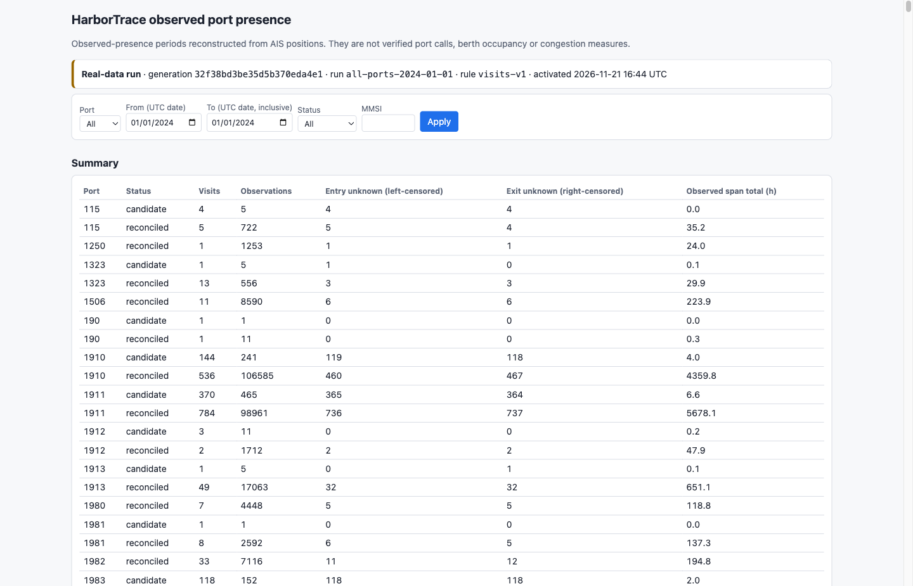

# Serving and analytics evidence: weeks 7–15

Recorded: 20 November 2026, Asia/Ho_Chi_Minh.
Component owner: Nguyen Quang Huy (20235505).

This delivery completes the locally executable component work after week 6.
It supplies implementation, tests, measured examples, report sections, and presentation material.
It does not claim that all course acceptance gates passed.

## Weekly acceptance

| Week | Delivered and exercised | Remaining external evidence |
|---|---|---|
| 7 | Consistent port, date, status, and vessel filters. uncertainty and provenance. empty states. 205-port synthetic coverage | Dashboard review on larger real artifacts |
| 8 | Complete generation publication, replacement snapshots, retries, stale rejection, and expired publisher protection | Read consistency on deployed services |
| 9 | Current Spark engine output enters real MongoDB and HTTP with matching counts. aggregate and time-series pipeline executes | Joint reconciliation on the full real input and team services |
| 10 | Parameterized service URI. Spark windows, pivot/unpivot, custom folds, duration function, and join plans | Remote execution, restricted accounts, and transport security |
| 11 | MLlib evaluation and actual GraphFrames execution on labeled synthetic input | Qualifying real samples, interpretation, and the 26-case human review |
| 12 | Local query measurements, application alerts, and constant-space timing summaries | Measurements and monitoring collection on deployed infrastructure |
| 13 | Real MongoDB concurrency tests, an actually killed publisher, retry recovery, and HTTP access responses | Deployed database restart, access roles, backup restoration, and cluster recovery |
| 14 | [Report contribution](serving_report.md), this evidence index, and [eight-slide presentation source](serving_presentation.md) | Assembly and review of the team report and deck |
| 15 | Regression corrections and reproducible component commands | Individual defense and findings from team acceptance |

The revised November schedule also requests an engine-directory applier.
`serving_import.py apply-directory` now imports `updates/batch=*/` without a Spark dependency in the serving process.
The existing engine is already on the base branch.
This record does not invent a separate human review of its earlier PR.

## Implementation boundaries

A generation contains one complete batch result.
A cohort contains visits managed by one provisional update sequence.
Generation initialization and completion compare status and publisher tokens before changing metadata.
An old publisher cannot downgrade a completed generation to `loading`.
The publisher rejects expired leases.

Provisional writers stage separate immutable snapshots and compare the prior pointer before publication.
Readers select rows from the pinned snapshot.
Old and abandoned snapshots remain stored to preserve readers.
This retention requires deliberate maintenance and consumes storage.

Retry content consists of mode, visit records, and deletion identities.
The engine assigns wall-clock emission times to attempts, so a retry can carry a new `emitted_at`.
That timestamp participates in snapshot identity, but it does not create a conflicting business update.
The winning snapshot retains its own emission metadata.

The directory importer compares completion markers and file metadata before and after capturing batch bytes.
A batch that changes during capture remains pending.
Receipts hash normalized updates independently of Spark filenames, row order, and attempt emission times.
A changed business payload conflicts with an existing receipt.
The importer preserves the selected source identity across retries.

A receipt follows all successful cohort updates in a batch.
It does not provide a transaction across cohorts.
If an update fails after earlier updates succeed, a retry resumes through their identities.
A newer update that loses a pointer race causes a retryable failure instead of being silently classified as old.

## Observed execution

The machine used macOS 15.7.2 on Apple Silicon, Python 3.12.13, Java 17.0.21.1, Spark 3.5.7, and MongoDB 8.0.17.
MongoDB listened on `127.0.0.1:27027` with a separate temporary data directory.
The test and evidence commands created random `harbortrace_it_*` databases and removed them afterward.

The final full suite returned `233 passed, 2 skipped, 16 warnings` in 67.22 seconds.
The two skips require the absent Hadoop client.
The warnings concern deprecated version comparisons inside PySpark.

| Experiment | Observed result | Interpretation |
|---|---|---|
| Real MongoDB integration suites | 29 tests passed in 8.92 seconds | Includes publication races, provisional races, invalid input, disposable evidence, and killed-process recovery |
| Dashboard coverage | 14 tests passed | Includes 205 synthetic ports, all summaries beyond the 200-row table limit, and generation-pinned port choices |
| Directory importer | 17 tests passed | Includes numeric ordering, marker changes, Spark retry names, content conflicts, and interrupted batches |
| Committed real AIS excerpt through current Spark engine | 2 observations produced 1 reconciled visit in 5.165 seconds | A small real example, not the full pilot or an accuracy study |
| Real excerpt through MongoDB and HTTP | Manifest, stored, summary, and HTTP totals all equaled 1 | The result crossed the current engine/serving boundary |
| Synthetic streaming through the actual Spark file sink | 8 messages: 7 accepted and 1 duplicate. 2 provisional visits | File-fed streaming behavior only |
| Engine directories through real MongoDB | 2 batches and 2 updates applied. repeating the import reused both receipts | Current Spark output is accepted without loading Spark in serving |
| Actual HTTP access and alerts | Missing token returned 401. removing one stored record caused health HTTP 503 | Count mismatch and access responses work locally |
| MongoDB query plan | Winning plan contained `FETCH` and `IXSCAN` | The generation/port query used an index on this input |

The real excerpt visit file had SHA-256 `ee255fb73664e9019f92cbfdb44d0ffd9a26f8d115fbd78b14be89b82b86d3bc`.
It retained uncertainty and source evidence from the two committed observations.
The larger engine pilot arrived after this run. Its results appear in the [all-ports trial](#real-ais-trial-for-all-ports-on-1-january-2024).

### Query measurements

Each operation ran five times after publication on the same local standalone server.
These are median elapsed milliseconds, without a controlled cold-cache comparison.

| Operation | One-visit real excerpt | Twelve-visit synthetic batch |
|---|---|---|
| Visit query | 2.045 | 1.278 |
| Summary query | 0.789 | 1.229 |
| Hourly query | 0.460 | 0.444 |
| HTTP visit endpoint | 1.760 | 1.876 |

These measurements come from the recorded `real-excerpt-final-evidence.json` and `stream-final-evidence.json` runs.
They do not predict deployed latency or large-input behavior.
The timing summaries retain count, total, and maximum with fixed storage per metric.
A regression exercises 100,000 observations and makes sure that retained memory does not grow with observation count.

### Analytics execution

The synthetic generator produced 1,979 visits over twelve ports.
Ten ports passed the project gate of twenty complete reconciled visits per port.
KMeans selected two clusters with mean silhouette `0.5778474` and seed agreement `1.0`.
The result records every seed score and identifies the exported assignment's representative seed.
The generated profiles intentionally differ, so these clusters do not describe real ports.

GraphFrames `0.12.3` actually executed PageRank and strongly connected components.
It used Maven package `io.graphframes:graphframes-spark3_2.12:0.12.3` and Python package `graphframes-py==0.12.3`.
The synthetic graph contained twelve vertices, 144 directed edges, and one strongly connected component.
The time series contained 170 port-days and twelve review flags.
Pivot/unpivot preserved totals, and the join experiments returned equal rows.

The full synthetic analytics command took 35.541 seconds.
Its aggregate phase took 4.746 seconds, MLlib took 14.211 seconds, and the graph phase took 6.265 seconds.
These phases include their Spark actions and exports.
There is no controlled before/after speedup measurement.
Driver-side result collection and per-group arrays still limit large-input execution.

The small twelve-visit fixture also ran GraphFrames with two vertices and two edges.
It produced PageRank `1.0` for each vertex and two strongly connected components.
Its zero qualifying ports correctly prevented clustering.

## Real AIS trial for all ports on 1 January 2024

The trial started on 21 November 2026 in Asia/Ho_Chi_Minh.
It used Python 3.12.13 and standalone MongoDB 8.0.17 on macOS 15.7.2 (Apple Silicon).
MongoDB listened on `127.0.0.1:27027`. The database `harbortrace_all_ports_20240101` started empty.

Khải supplied `huy-2024-01-01-all-ports.tar.gz`. The extracted files matched the archive byte for byte.
The stream contained 49 completion markers and 323,353 update lines. Batch `00000000` contained an empty part file.
Both imports read `data/stream/all-ports-2024-01-01` with source ID `all-ports-2024-01-01`.

### Streaming import and retry

| Pass | Batches applied | Batches reused | Updates applied | Update lines skipped | Elapsed (s) |
|---|---:|---:|---:|---:|---:|
| First | 49 | 0 | 323,353 | 0 | 350.899 |
| Retry | 0 | 49 | 0 | 323,353 via batch receipts | 13.306 |

Each receipt records a completed batch and its content hash. The retry read and validated every batch.
It matched all 49 receipts and returned an empty `updates` map. Both passes reported zero pending batches.
The first pass returned zero stale or duplicate updates. Neither pass raised an engine data error.
The first pass produced 20,375 current provisional visits across 10,562 cohorts, which are groups of streaming visits.
The cohort snapshot hash, 49 receipts, and 469,689 stored visit versions matched before and after the retry.

The times cover `update_import.apply_directory` only. The local serving tests ran during part of the first pass.

### Batch publication and dashboard

Serving validated `data/engine/all-ports-2024-01-01` in 0.378 seconds. The visit file matched the SHA-256 hash in the manifest.
Publication and activation took 1.046 seconds for generation `32f38bd3be35d5b370eda4e1`.
MongoDB, the manifest, `/api/visits`, and the sum from `/api/summary` each counted 20,487 batch visits across 204 ports.
The batch recorded 16,752 reconciled visits and 3,735 candidates.

The PR #7 trial exposed a replacement bug. After activation both endpoints still included the same 20,375 visit IDs.
The dashboard returned HTTP 200. Each cohort's recorded emission time exceeded the 15-minute lag threshold, so `/healthz` reported `degraded`.



The `test` dependency group in `pyproject.toml` includes `mongomock==4.3.0`.
The serving, importer, dashboard, and real MongoDB test suites returned 136 passed in 77.83 seconds.

### Provisional replacement on the January 1 data

On 23 November 2026, a fresh standalone MongoDB 8.0.17 imported the same 49 stream batches and 323,353 updates. Two local HTTP servers read that database before and after activation of the same batch generation. Each request used `limit=1` and returned HTTP 200. The table records the full JSON `total`. Every positive total returned one visit row, and each zero returned an empty list.

| Dashboard code | Batch before | Provisional before | Batch after | Provisional after |
|---|---:|---:|---:|---:|
| PR #7 behavior, reproduced on `2f0c948` | 0 | 20,375 | 20,487 | 20,375 |
| Active batch replaces matching visit IDs | 0 | 20,375 | 20,487 | 0 |

An independent comparison of all current cohort snapshots with the batch artifact found 20,375 shared visit IDs, 112 batch-only IDs and zero stream-only IDs. Activation preserved the 10,562 cohort pointers, 469,689 stored provisional versions and 49 receipt checksums. The API's `cohorts[].visit_count` describes the stored stream snapshot. Its `total` counts the matching provisional visits still visible after batch replacement.

Coverage uses the visit ID, which includes vessel, port, first inside time and rule version. The manifest supplies no explicit event-time coverage interval. Unmatched visits remain visible, including visits whose identity changes after a split or merge. Activating or rolling back a generation changes coverage on the next read. A MongoDB execution plan for 128 real cohorts showed 190 matching snapshot rows and 190 lookups on the batch `_id` index, with zero batch collection scans.

To reproduce the table's second row, extract the January 1 inputs under `data/` and run these commands from the repository root with Python 3.12, the serving requirements, `jq` and an isolated MongoDB server. The initial import stages the batch and creates the indexes. The stream remains visible until the explicit activation.

```bash
export PYTHONPATH=src:.
export HARBORTRACE_MONGO_URI=mongodb://127.0.0.1:27027
export HARBORTRACE_MONGO_READER_URI=mongodb://127.0.0.1:27027
jan1_db="harbortrace_jan1_$(date +%s)"
jan1_run=all-ports-2024-01-01
import_jan1() { python scripts/serving_import.py --database "$jan1_db" "$@"; }
probe_jan1() {
  for endpoint in visits provisional; do
    curl -fsS "http://127.0.0.1:8051/api/$endpoint?limit=1" |
      jq -c --arg endpoint "$endpoint" '{endpoint: $endpoint, total, returned: (.visits | length)}'
  done
}
import_jan1 import "data/engine/$jan1_run" --no-activate
python scripts/serve_dashboard.py --database "$jan1_db" --port 8051 &
jan1_dashboard=$!
import_jan1 apply-directory "data/stream/$jan1_run" --source-id "$jan1_run"
probe_jan1
import_jan1 activate 32f38bd3be35d5b370eda4e1
probe_jan1
kill "$jan1_dashboard"
```

## Reproduce the component

Use the repository root with Python 3.12, Java 17, and a running local MongoDB server.
The [week-6 guide](week06_serving.md#reproduce-the-tests) describes native MongoDB startup on port 27027.
Set `JAVA_HOME` to your installed Java 17 directory before the Spark commands.

```bash
python3.12 -m venv .venv
source .venv/bin/activate
python -m pip install -r requirements-serving.txt -r requirements-engine.txt
export HARBORTRACE_MONGO_URI=mongodb://127.0.0.1:27027
```

Run the full test suite against that server:

```bash
env -u PYTHONPATH PYTEST_DISABLE_PLUGIN_AUTOLOAD=1 \
  JAVA_HOME="$JAVA_HOME" SPARK_LOCAL_IP=127.0.0.1 \
  HARBORTRACE_TEST_MONGO_URI="$HARBORTRACE_MONGO_URI" \
  python -m pytest -q -rs
```

Use new output paths for each artifact or analytics run.
These commands create the real excerpt artifact and disposable serving evidence:

```bash
PYTHONPATH=src SPARK_LOCAL_IP=127.0.0.1 python scripts/engine_batch.py \
  --real --input tests/fixtures/real_ais_excerpt.jsonl \
  --run-id huy-real-excerpt-20261120 --ports 4120 4110 \
  --output data/engine/huy-real-excerpt-20261120

PYTHONPATH=src:. python scripts/serving_evidence.py \
  --artifact data/engine/huy-real-excerpt-20261120 \
  --output data/serving/real-excerpt-evidence.json
```

Run the file-fed streaming example and its directory import:

```bash
mkdir -p data/stream/huy-weeks07-15-input
cp tests/fixtures/canonical/week06_replay.jsonl data/stream/huy-weeks07-15-input/input.jsonl
PYTHONPATH=src SPARK_LOCAL_IP=127.0.0.1 python scripts/engine_stream.py \
  --source data/stream/huy-weeks07-15-input --output data/stream/huy-weeks07-15 \
  --stream-id huy-weeks07-15 --ports 9001

PYTHONPATH=src:. python scripts/serving_evidence.py \
  --artifact tests/fixtures/serving/generation_a --updates data/stream/huy-weeks07-15 \
  --output data/serving/stream-evidence.json
```

The evidence command imports, repeats the import, compares counts, measures queries, probes HTTP, and removes its database.
It never records the MongoDB URI.
Use the serving guide's `apply-directory` command to retain results in a selected development database.

Install the optional GraphFrames Python package in the activated environment before this analytics command:

```bash
python -m pip install graphframes-py==0.12.3
PYTHONPATH=src SPARK_LOCAL_IP=127.0.0.1 python scripts/analytics_run.py --synthetic \
  --packages io.graphframes:graphframes-spark3_2.12:0.12.3 \
  --output-dir data/analytics/huy-synthetic
```

## Evidence limits and attribution

The tests skip HDFS client cases when Hadoop is absent.
Local MongoDB does not establish replication, authenticated roles, TLS, backup restoration, or availability after database restart.
The current run does not exercise the team's long-lived Kafka, HDFS, MongoDB, or a deployed cluster.
Real model evaluation still requires suitable port coverage and independent interpretation.
The human 26-case review, team review, and defense remain external activities.

Independent AI review found the Spark receipt and stale-publication races before this PR.
Regression tests reproduced the findings before the corrections.
This review does not replace the required human peer review.
The [report](serving_report.md) and [presentation source](serving_presentation.md) preserve these distinctions for team assembly.
AI assistants supported code, tests, and writing, and the owner must review and explain the contribution.
