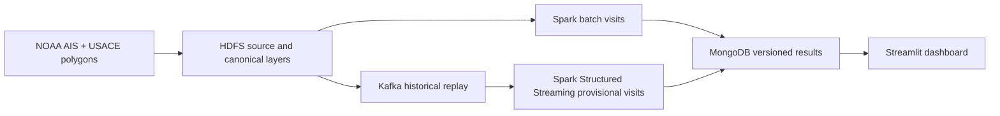

# Week 1: HarborTrace proposal

## Problem and scope

HarborTrace aims to reconstruct **observed presence in port areas** from historical AIS vessel positions. The first geographic scope is the Los Angeles and Long Beach statistical port areas. A visit will carry its supporting observations, time bounds, quality flags, and uncertainty. Observed presence is not proof of berth occupancy, cargo handling, or true congestion.

The project is suitable for a big data course because a daily national AIS file contains millions of observations, while duplicates, missing coverage, out-of-order events, geometry checks, and repeatable storage complicate a simple point-in-polygon query.

## Proposed inputs

| Input | Provider | Planned use |
|---|---|---|
| [2024 historical AIS GeoParquet](https://github.com/ocm-marinecadastre/ais-vessel-traffic/blob/main/data/ais-broadcast-points-2024-readme.md) | NOAA Office for Coastal Management | Event-time positions and vessel identifiers; source files kept immutable with checksums. |
| [Port Statistical Area feature service](https://services7.arcgis.com/n1YM8pTrFmm7L4hs/arcgis/rest/services/Port_Statistical_Area/FeatureServer/0) | US Army Corps of Engineers | Port-area polygons and their metadata; boundaries and data years recorded. |

AIS is provider-processed historical data, not live radio messages. Polygon boundaries are port areas, not berths. Their vintage, AIS gaps, and MMSI identity uncertainty will be assessed before making claims about visits.

## Target architecture

This is a target design for later milestones. Week 1 checks only the local Spark runtime. Planned development proceeds from source inspection and small rule fixtures to one real day, a bounded fourteen-day core, streaming/reconciliation, evaluation, and presentation. Cloud execution and human validation require separate evidence.

## Week 1 acceptance

1. Record the problem, scope, two source providers, and limits above.
2. Pin the minimal Python dependencies needed for a Spark smoke test.
3. Run `python scripts/spark_smoke.py` in the documented WSL environment and record `range(5).count() = 5`.
4. Keep datasets, environments, credentials, and generated output out of Git.

The local smoke test has passed with Spark 3.5.7. A more complete prototype existed locally before this Git repository's first commit; this commit deliberately publishes the week-one deliverable. Later commits should document actual review, changes, and new evidence rather than imply that commit dates are code authorship dates. Code and prose were prepared with Codex assistance and need team review under the course policy.
