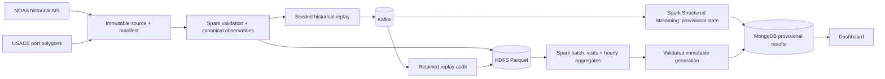

# Week 3: Lambda architecture (batch and speed paths) and capstone design

HarborTrace reconstructs **observed vessel presence** in Los Angeles and Long Beach from AIS (Automatic Identification System) positions. The [proposal](week01_proposal.md) defines the problem; the [week-two HDFS (Hadoop Distributed File System) check](week02_hadoop.md) verifies local storage. This milestone fixes the end-to-end design and contracts (shared data-field and behavior requirements).

## Data flow

Sources are NOAA (National Oceanic and Atmospheric Administration) observations and USACE (U.S. Army Corps of Engineers) boundaries. Spark (a distributed processing engine) computes results; Kafka (an event-streaming platform) transports replay; MongoDB (a document database) serves results. Parquet (column-oriented files) holds canonical (normalized) observations. A manifest (an input/run metadata record) preserves provenance (traceability to source evidence).

This is a **Lambda architecture**: a deterministic batch path is the authority for reconciled history, while a speed path shows provisional state during replay. A replay carries original event time and a separate ingestion time. It simulates delayed and duplicated arrivals from a historical source; it is not a live AIS receiver. Both paths use the same canonical observation and visit-rule versions. A changed or late observation is retained for investigation and a batch rebuild can correct the provisional result. The design does not claim that an event-time watermark can recover data already discarded from streaming state.

| Component | Role | Planned check |
|---|---|---|
| NOAA and USACE snapshots | Immutable, checksummed source and boundary provenance | Source manifest, boundary metadata, row accounting |
| HDFS and Parquet | Distributed storage interface for source, canonical, replay audit, batch output | Read/write check first; later Spark read and partition scan |
| Kafka | Bounded, seeded historical replay | Message IDs, duplicate and delay injection, retained count |
| Spark batch | Canonicalization, spatial join, deterministic visit reconstruction, aggregates | Reference fixtures, full input counts, repeatable output IDs |
| Spark Structured Streaming | Event-time provisional visits with bounded state and watermark | Late data, duplicate, restart, and state-limit scenarios |
| MongoDB | Versioned serving collections and active generation pointer | Count validation, reader consistency, failed-publication recovery |
| Dashboard | Clearly labelled reconciled and provisional views | Reads one complete generation and displays uncertainty |

## Authority and publication

1. Keep source bytes and original boundary geometry unchanged. A manifest records checksums, provider, extraction time, and rule/config versions.
2. Account for every source row as canonical, outside the regional selection, duplicate, conflicting, or invalid. Retain observations outside a port polygon but within the regional selection to establish possible exits.
3. Sort by UTC (Coordinated Universal Time) event time and stable IDs (identifiers) before applying the [visit decision table](visit_decision_table.md). Batch results are reproducible for fixed source, boundary, configuration, and code versions.
4. The speed path labels output `provisional`. Its watermark and state limits are explicit; delayed events outside that limit require batch reconciliation.
5. Write a complete batch generation, validate counts, then switch one serving pointer. Readers pin that generation for a request. Retain old generations for audit until a separate cleanup decision.

## Course requirements and present boundary

The proposed pipeline covers ingestion, Spark processing, HDFS storage, Kafka messaging, MongoDB serving, and visualization. Later milestones must show actual Spark window/aggregation, joins and physical plans, partition and cache decisions, streaming watermark/recovery, analytics, monitoring, and a deployment beyond Docker alone. The [data contract](week03_contracts.md) defines the evidence those checks should use.

The week-one Spark smoke and week-two **single-DataNode** HDFS round trip are the published executable checks so far. The complete local prototype was developed before these staged weekly commits; these documents record the reviewed week-three design, not original code authorship dates. This local profile is not evidence of multi-node fault tolerance, Kubernetes/cloud deployment, or true berth occupancy. No dataset or generated result belongs in this commit.
