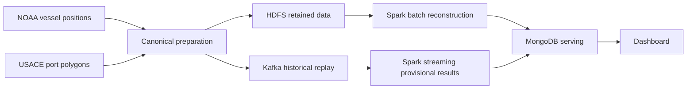
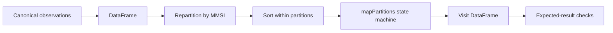

# HarborTrace checkpoint: project explanation and demonstration guide

This guide accompanies `scripts/week04_checkpoint.py`. The runnable checkpoint was verified on 25 October 2026 by exporting the Git release files to a clean directory and executing the demo in the existing WSL Python environment. It returned `PASS` with exit code 0.

Start with part 0 for the problem and terminology. Parts 1-5 cover execution and results. Parts 6-9 explain Spark, data, architecture, and likely questions. Parts 10-13 provide an introduction, a source map, a five-minute demonstration, and a self-check.

**0. The problem, inputs, and outputs**

HarborTrace reconstructs observed vessel presence in the Los Angeles and Long Beach port areas from historical AIS positions. It transforms individual records of "which vessel, when, and where" into visits describing when a vessel was observed inside a port area, whether the observations meet the confirmation rule, and what evidence is missing.

A vessel can produce many position records during one period in a port area. Counting records therefore depends on reporting frequency and coverage. To identify periods of presence, the project groups observations by vessel, orders them by time, and applies explicit rules. Duplicates, missing observations, out-of-order arrivals, and boundary uncertainty complicate this reconstruction.

Visits can support summaries of observed activity by port and hour and distributions of observed spans. Each result retains quality flags and source evidence. Verified commercial calls, berth occupancy, cargo handling, and actual congestion require additional independent data.

| Question | Project answer |
|---|---|
| What are the inputs? | Historical NOAA AIS positions and USACE port polygons. |
| What transformations are needed? | Validate and normalize records, assign positions to port areas, group by vessel and time, and apply visit rules. |
| What are the outputs? | Visits with observed times, status, uncertainty flags, and source provenance; the target system also serves aggregates and a dashboard. |
| What does this checkpoint execute? | Spark batch reconstruction from observations with existing port assignments, checked against expected results. |
| Why a big data system? | Real daily inputs contain millions of records. Storage, processing by key, replay, and reconciliation must be evaluated beyond the small acceptance fixture. |

Consider this synthetic sequence after port assignment:

| Vessel | UTC time | Position relative to the port |
|---|---|---|
| A | 00:00 | Outside |
| A | 00:05 | Inside |
| A | 00:15 | Inside |
| A | 00:20 | Outside |
| A | 00:30 | Outside |

These five observations produce one visit. The two inside observations are ten minutes apart, satisfying the confirmation rule. Outside observations on both sides constrain the possible entry and exit intervals. Parts 3-4 explain the calculation.

| Term | Meaning in HarborTrace |
|---|---|
| AIS | Vessel identification and position observations; the project uses provider-processed NOAA historical records. |
| MMSI | A maritime radio identifier used as the grouping key, with limitations as a vessel identity over time. |
| Polygon | A geographic shape representing a selected port boundary. |
| `assignment` | The port assigned to an observation: `4120` is Los Angeles and `4110` is Long Beach. In the fixture, `null` means outside the tested port. Real data can also be ambiguous, requiring flags. |
| Canonical observation | A normalized record with UTC event time, coordinates, identities, assignment, and quality flags. |
| Visit | A period of observed presence reconstructed under a specified rule version. |
| Fixture | A deliberately designed test dataset with expected results. |
| Batch | Processing an available input range, such as a historical day. |
| Streaming | Processing events as they arrive; the design tests this using historical replay. |
| State | Information retained between observations, such as whether entry is confirmed or an exit is pending. |
| Partition | A portion of data processed by a Spark task; a partition is not a physical worker machine. |

The target system has batch and speed paths:



Batch reconstructs the selected history. The speed path produces provisional results while replayed events arrive. HDFS retains data for repeatable reads, Kafka transports events, and MongoDB supports serving queries. The [architecture document](week03_architecture.md) also describes validating a complete generation before changing the active serving pointer.

| Scope | Contents | Available evidence |
|---|---|---|
| Published week-four checkpoint | Spark reconstruction, synthetic cases, a real NOAA excerpt, contracts, rules, and architecture documents. | Clone the repository, install the pinned dependencies, and run the README command. |
| Fuller local prototype | Pilot source, canonical data, prior results and manifests, and additional modules outside the checkpoint commit. | Inspect the local files and manifests described in part 7. |
| Final course system | The complete pipeline, evaluation, and deployment evidence required by the rubric. | Requires the corresponding implementation releases, experiments, and actual deployment. |

The checkpoint command executes one business-processing slice. It uses existing assignments and does not download the full source, rerun spatial assignment, or start every service in the target architecture.

**1. Run the checkpoint**

For a fresh checkout, use Ubuntu / WSL2, Python 3.12, and Java 17:

```bash
git clone https://github.com/nxk176/big_data_group_15.git
cd big_data_group_15
python3 -m venv .venv
source .venv/bin/activate
python -m pip install -r requirements-week04.txt
PYTHONPATH=src python scripts/week04_checkpoint.py --details
```

If the repository is already present, run the environment and demo commands from its root. On the existing project laptop, the following PowerShell command uses the already installed environment:

```powershell
wsl.exe -- bash -lc 'cd /mnt/e/big_data && source ~/.venvs/harbortrace/bin/activate && PYTHONPATH=src python scripts/week04_checkpoint.py --details'
```

Or enter Ubuntu with `wsl` and run:

```bash
cd /mnt/e/big_data
source ~/.venvs/harbortrace/bin/activate
PYTHONPATH=src python scripts/week04_checkpoint.py --details
```

`/mnt/e/big_data` is the WSL view of `E:\big_data`. `source` activates the Python environment. `PYTHONPATH=src` makes the project package available to the driver and Python workers. `--details` prints individual visits, the physical plan, and the real excerpt result; omit it for the summary alone.

Verified runs took roughly 15-18 seconds on the laptop, with runtime depending on the environment. Output appears in the terminal. The script stops Spark when finished and does not launch a dashboard.

**2. Interpret the summary**

```json
{
  "fixture_cases": 5,
  "input_observations": 23,
  "real_excerpt_observations": 2,
  "real_excerpt_visits": 1,
  "result": "PASS",
  "sort_in_physical_plan": true,
  "spark_version": "3.5.7",
  "status_counts": {"candidate": 1, "reconciled": 5},
  "visits": 6
}
```

| Field | Interpretation |
|---|---|
| `fixture_cases: 5` | Five designed scenarios with expected results in JSON. |
| `input_observations: 23` | Synthetic observations only; excludes the two real records. |
| `visits: 6` | Synthetic output visits. The long-gap scenario produces two visits. |
| `reconciled: 5` | Five synthetic visits satisfy the observed-presence confirmation rule. |
| `candidate: 1` | One synthetic visit has insufficient temporal evidence for confirmation. |
| `real_excerpt_observations: 2` | The actual row count read from the real excerpt, checked by the script. |
| `real_excerpt_visits: 1` | One separate real-data visit, excluded from `visits` and `status_counts` above. |
| `sort_in_physical_plan: true` | The synthetic observation DataFrame's executed plan contains a `Sort` operator. |
| `result: PASS` | Visit counts, the properties specified in the fixture, the sort check, and the real excerpt assertions passed. This is not a real-world accuracy score. |

**3. Visit rules and state**

An observation records one vessel position at one time. A visit combines a sequence of observations into a period of observed presence under `visits-v1`:

- An inside observation starts a candidate.
- Inside observations spanning at least ten minutes within the active period confirm presence.
- The first outside observation starts a pending exit. Two outside observations at least ten minutes apart confirm the exit.
- An inside observation before exit confirmation cancels the pending exit and adds a short-excursion/boundary-jitter flag.
- A consecutive observation gap greater than thirty minutes breaks continuity. The old period closes with uncertainty, and processing starts afresh from the current observation.
- End of input closes an active visit with a right-censoring flag if no exit was confirmed.

The 10/10/30-minute thresholds are configurable hypotheses requiring sensitivity analysis. They are not established maritime standards. Exactly thirty minutes does not trigger the `> 30` gap condition.

The state machine remembers first and last inside times, the preceding outside time, a pending exit, counts, and flags. Independent point classification alone cannot determine whether a period has sufficient temporal evidence or whether a brief outside point should end a visit.

**4. Five scenarios**

| Case | Key observations | Expected result |
|---|---|---|
| `normal_entry_exit` | Outside at 00:00; inside at 00:05 and 00:15; outside at 00:20 and 00:30. | One reconciled visit with a 600-second observed span and bounded entry/exit intervals. |
| `crosses_midnight` | Inside observations from 23:55 to 00:05 the next day. | One reconciled visit spanning 600 seconds; midnight alone does not split it. |
| `long_gap_splits` | Inside at 00:05 and 00:15, then at 01:00. | The 45-minute gap splits two visits: the first reconciled, the second a candidate with one observation. |
| `input_range_censoring` | Only inside observations at 00:00 and 00:10. | Confirmed presence, with both ends censored because outside evidence is missing. |
| `short_excursion` | Inside at 00:05 and 00:15; outside at 00:20; inside at 00:25; outside at 00:30 and 00:40. | One reconciled visit spanning 1,200 seconds, with a short-excursion/boundary-jitter flag. |

The normal case can be drawn as:

```text
00:00 outside -> 00:05 inside -> 00:15 inside -> 00:20 outside -> 00:30 outside
```

The observations constrain possible entry to 00:00-00:05 and possible exit to 00:15-00:20 under the model. They do not identify precise arrival or departure times. `observed_span_seconds = last_inside - first_inside = 600` measures the interval between the first and last inside observations, without proving uninterrupted occupancy.

**5. The real NOAA excerpt**

The two observations for MMSI `367721190` occur at `02:35:34Z` and `02:53:34Z` on 1 January 2024, both assigned to port `4120` (Los Angeles). Their separation is eighteen minutes, or 1,080 seconds: enough for the confirmation threshold and below the gap threshold.

| Output property | Interpretation |
|---|---|
| `observation_count: 2` | Two inside observations support the visit. |
| `observed_span_seconds: 1080` | Time between the two observations. |
| `status: reconciled` | The batch confirmation rule was met. |
| `left_censored: true` | No preceding outside observation establishes the lower entry bound. |
| `right_censored: true` | No outside pair confirms an exit or establishes an upper exit bound. |
| `possible_entry_after: null` | The prior outside time is unknown. |
| `possible_entry_by` | The first inside observation constrains the latest possible entry under the model. |
| `possible_exit_after` | The last observed inside time. |
| `possible_exit_by: null` | The upper exit bound is unknown. |
| `boundary_topology_repaired` | Assignment used a repaired Los Angeles geometry; the uncertainty is retained. |
| `input_range_ended` | Input ended while the visit was still active. |
| `source_record_ids`, `source_digest` | Traceability to supporting source records and repeatability checks. |

Confirmation and censoring describe different properties. A visit can have sufficient evidence of observed presence while lacking complete entry and exit bounds. The vessel need not have left the port when the file ends. `reconciled` is the batch status under these rules, not independent confirmation of a commercial port call.

**6. What Spark executes**



`repartition(2, "mmsi")` shuffles records by the MMSI hash. All observations for one MMSI go to the same partition; each partition can contain several MMSIs. Repartitioning has a data-movement cost and does not itself guarantee event-time order.

`sortWithinPartitions("mmsi", "event_time", "logical_id", "source_record_id")` establishes the sequence required by the state machine. Canonical timestamps in the demo use a consistent UTC ISO representation. Stable IDs break ties. In the plan, `Exchange hashpartitioning(mmsi, 2)` performs redistribution and `Sort [...]` orders each partition. This is not a global sort.

`mapPartitions` applies the state machine to a partition iterator. When MMSI changes, it closes the previous vessel's state and initializes the next one. The code uses RDD `mapPartitions` for sequential stateful logic, rather than a SQL UDF. Trade-offs include Python/JVM serialization and reduced Catalyst visibility inside the Python function.

`local[2]` runs Spark on the laptop with up to two concurrent tasks; it is not a two-machine deployment. The demo collects a few output rows to the driver for assertions. Large results should be written to storage rather than collected wholesale. This fixture is an acceptance check, not a scalability benchmark.

Primary documentation: [sortWithinPartitions](https://spark.apache.org/docs/3.5.7/api/python/reference/pyspark.sql/api/pyspark.sql.DataFrame.sortWithinPartitions.html) and [application submission/master settings](https://spark.apache.org/docs/3.5.7/submitting-applications.html).

**7. Full data and provenance**

NOAA 2024 AIS is provider-processed historical data. The boundary snapshot uses the USACE **Ports layer, ID 0**; PortStatisticalAreas is a separate ID 1 layer.

The local pilot for 1 January 2024 contains:

- `data/source/ais-2024-01-01.parquet`: 227,181,435 bytes and 7,293,408 source rows.
- `data/canonical/ais-2024-01-01-regional.parquet`: 235,713 regional observations, including outside-polygon observations retained within the selected region to support entry/exit reconstruction.
- Row accounting: `235,713 canonical + 7 duplicates + 7,057,688 outside-region = 7,293,408 source rows`.
- Previously measured full-pilot batch output: 370 visits, comprising 271 reconciled and 99 candidates. The checkpoint command does not rebuild that full output.
- A two-row canonical excerpt included in Git, alongside the separate synthetic scenarios.

The local prototype prepares source data using PyArrow/SQLite and Shapely. Spark reconstructs visits and performs batch analytics. The checkpoint receives existing assignments and does not rerun spatial classification. SHA-256 verifies a specific file's bytes, not the correctness of observations or business conclusions.

Synthetic fixture coordinates are placeholders; assignments are specified by the scenario. Two synthetic events can therefore share placeholder coordinates while having different assignments. This deliberately isolates the state-machine tests from geometry. The real excerpt retains canonical coordinates, assignments, identities, and quality flags. Neither sample retests the point-in-polygon implementation.

The [checkpoint note](week04_checkpoint.md) records provider URLs, checksums, and pilot evidence. Local source and canonical manifests allow inspection without putting the large data files into Git.

**8. Relation to Lambda architecture**

The [architecture diagram](week03_architecture.md) separates batch reconstruction from provisional streaming. Kafka replays historical events into the speed path. A batch rebuild over the selected canonical history provides the reconciliation authority when late data affects provisional output. HDFS retains data; MongoDB serves results by generation; dashboard requests pin a generation.

This command exercises only the batch reconstruction slice on local files. The [week-two HDFS check](week02_hadoop.md) is a separate storage test. Kafka, MongoDB, and the dashboard are not started by the checkpoint script. A prepared diagram, locally implemented modules, published code, and executed deployment evidence have different evidentiary scopes.

**9. Questions and evidence-based answers**

| Question | Answer |
|---|---|
| Where is the big data if the real sample has two rows? | The excerpt supports quick repeatable acceptance checks. Full-pilot source size and row accounting are documented. Scalability must be measured on larger inputs. |
| Why not count points inside a polygon? | Point counts depend on reporting frequency and coverage. Visits require grouping by vessel/time and handling gaps, excursions, and censoring. |
| Is this a verified port call? | It is observed area presence under explicit rules. Independent berth/call evidence is still needed. |
| Is the input live? | NOAA supplies historical observations. The Kafka design replays history with controlled delay and duplicates. |
| What does `PASS` establish? | Expected visit counts and specified properties, the sort check, and real-excerpt assertions passed. It does not establish whole-dataset accuracy, throughput, or fault tolerance. |
| Why Spark instead of pandas? | pandas is sufficient for the fixture. Spark supports the larger processing design; actual benchmark evidence is needed to justify performance claims. |
| Why must observations be sorted? | State transitions depend on event order. Repartitioning alone does not order the sequence. |
| What about a vessel with many observations? | It can skew a partition. Measure skew and resources; splitting a vessel requires a design for reconciling state at partition boundaries. |
| Is exactly-once already demonstrated? | This batch demo does not test streaming delivery/sink guarantees. Identities, checkpoint recovery, and sink idempotency need separate evidence. |
| Why retain candidates? | They preserve limited evidence without treating it as confirmed activity. Default confirmed aggregates exclude them. |
| Why flag a repaired polygon? | The Los Angeles source geometry was invalid. Original bytes remain intact; derived repair can change assignment and must remain visible. |
| Does the checkpoint finish the course project? | It provides executable code, data examples/provenance, and architecture. Broader Spark, streaming, evaluation, and Kubernetes/cloud deployment requirements still need their own releases and evidence. |

**10. Suggested introduction and troubleshooting**

"HarborTrace reconstructs observed vessel presence in the Los Angeles and Long Beach port areas from historical AIS positions. We have prepared NOAA source data and USACE boundaries, designed a Lambda architecture, and checked local HDFS storage. This demonstration runs the Spark batch slice: group by MMSI, sort by event time, and apply a visit state machine. Five fixtures with expected answers exercise gaps and missing bounds, and a small real excerpt checks the same processing path. Results retain uncertainty flags rather than claiming precise berth arrival and departure times."

Known hostname and `NativeCodeLoader` warnings occurred in successful local runs. Continue to the final result. A traceback, `AssertionError`, or missing `PASS` requires investigation before presenting. `ModuleNotFoundError: harbortrace` commonly indicates a missing `PYTHONPATH=src` or an incorrect working directory. Check `java -version` and `python --version` inside WSL. Linux commands must run in WSL, not directly in PowerShell.

**11. Source map and execution walkthrough**

| Topic | File | Relevant part |
|---|---|---|
| System architecture | [week03_architecture.md](week03_architecture.md) | Batch/speed paths and component roles. |
| Fixture inputs and expected output | [reference_cases.json](../tests/fixtures/reference_cases.json) | `events` contains input sequences; `expected` specifies checked visit properties. |
| Real excerpt | [real_ais_excerpt.jsonl](../tests/fixtures/real_ais_excerpt.jsonl) | Same MMSI, eighteen-minute interval, port `4120`, and repaired-boundary flag. |
| Executable entry point | [week04_checkpoint.py](../scripts/week04_checkpoint.py) | `main()` prepares observations/configuration, runs Spark, and checks results. |
| Distribution and ordering | [spark_core.py](../src/harbortrace/spark_core.py) | `reconstruct_frame()` calls repartition, sort, and `mapPartitions`. |
| Partition processing | [spark_core.py](../src/harbortrace/spark_core.py) | `_reconstruct_partition()` changes state machines when the MMSI changes. |
| Visit rules | [visits.py](../src/harbortrace/visits.py) | `Rules` holds thresholds; `VisitMachine.feed()` handles observations. |
| Visit output | [visits.py](../src/harbortrace/visits.py) | `_finish()` creates visits and flags; `close()` ends an active input range. |
| Data contracts | [contracts.py](../src/harbortrace/contracts.py) | `Observation`, `Visit`, and the `digest()` identity helper. |
| Dependencies | [requirements-week04.txt](../requirements-week04.txt) | Pinned PySpark and Py4J versions. |

The driver computes and checks results in this order:

1. Read five JSON scenarios, giving each a distinct synthetic MMSI.
2. Create 23 observations with UTC time, identities, and assignment. Set `local[2]`, two shuffle partitions, and the 10/10/30-minute rules.
3. Create the synthetic Spark DataFrame; read the real excerpt directly as JSONL for its separate run.
4. Repartition by MMSI, sort, and reconstruct visits using the partition iterator.
5. Collect the small output and compare visit counts and the properties specified by `expected`; raise `AssertionError` on a mismatch.
6. Verify that the real excerpt has two observations yielding one reconciled, 1,080-second visit with both ends censored.
7. Print optional details and the summary, and stop Spark in `finally`.

The synthetic driver uses `parallelize` because the fixture is deliberately small. The full local batch instead reads canonical Parquet. Collecting a handful of acceptance-test results does not justify collecting the full dataset into driver memory.

If the confirmation threshold changed from ten to twenty minutes, the normal ten-minute visit and the eighteen-minute real excerpt would not meet the new threshold. Their existing expected results are written for `visits-v1`, so changing rules without updating the versioned expectations should fail the checks. This can be explained without editing the demo during the presentation.

**12. Five-minute demonstration**

Prepare the architecture preview, a terminal, the fixture, and `spark_core.py`. The [README](../README.md) contains the fresh-checkout commands; part 1 also gives the existing laptop command.

| Time | Action | Explain |
|---|---|---|
| 0:00-0:45 | Open the architecture. | Position observations become visits; today's executable slice is Spark batch. |
| 0:45-1:20 | Open fixture and real excerpt. | Designed cases provide expected answers; the excerpt comes from canonical NOAA data. |
| 1:20-2:00 | Run the demo with `--details`. | Group by vessel, sort by event time, and update visit state. |
| 2:00-3:00 | Show normal, long-gap, and summary output. | Five scenarios produce six visits because the long gap splits one scenario. |
| 3:00-4:00 | Show the real visit JSON. | Eighteen minutes confirms presence, while missing outside evidence censors both ends. |
| 4:00-5:00 | Open `reconstruct_frame()`. | Identify actual shuffle/sort operators and describe the next ingestion, streaming, serving, and evaluation milestones. |

On the existing laptop, inspect the local full-pilot evidence from PowerShell without redownloading data:

```powershell
Get-Item E:\big_data\data\source\ais-2024-01-01.parquet |
  Select-Object Name, Length

$pilotManifest = Get-Content -Raw -Encoding utf8 E:\big_data\data\canonical\ais-2024-01-01-regional.manifest.json | ConvertFrom-Json
$pilotManifest.row_accounting | Format-List
```

The row categories must sum to the source count. This inspects a previously prepared local snapshot, while the small checkpoint exercises a bounded portion of the processing logic. A fresh Git checkout does not include those large pilot files; use the documented provenance and committed excerpt there.

**13. Self-check before presenting**

Practice answering in your own words, then compare with the indicated parts:

1. What are the inputs and outputs, and how does a visit differ from an observation? (Part 0.)
2. Why group by vessel and sort by time? Does repartitioning sort records? (Part 6.)
3. Why do five scenarios produce six visits, and which scenario creates the candidate? (Part 4.)
4. How far apart are the real observations, and why is the resulting visit both reconciled and censored? (Part 5.)
5. What does `PASS` check, and what evidence remains for accuracy, streaming, and fault tolerance? (Parts 2 and 9.)
6. Where are synthetic cases, the real excerpt, and the full pilot? Which counts belong to each? (Part 7.)
7. Which functions distribute records, apply business rules, and compare expected output? (Part 11.)
8. Which Lambda path runs today, and which components belong to the wider design or later releases? (Parts 8 and 12.)

The central explanation is: position observations become periods of observed presence under explicit rules. Spark organizes the data by vessel and time, the state machine creates visits, fixtures check expected behavior, and uncertainty flags preserve the limits of incomplete evidence.
