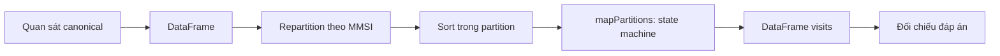

# Hướng dẫn chạy và giải thích demo checkpoint HarborTrace

Tài liệu này đi cùng `scripts/week04_checkpoint.py` trong gói checkpoint tuần 4. Các kết quả chi tiết dưới đây đã được chạy với `--details` ngày 22/10/2026. Người lấy repo về có thể làm theo phần “Run the checkpoint” trong [README](../README.md) để thiết lập môi trường và chạy demo.

Kiểm tra phát hành ngày 25/10/2026: xuất đúng các tệp staged của Git sang thư mục sạch và chạy lại bằng môi trường WSL đã có. Demo trả về `PASS`, exit code 0; thư mục kiểm tra không chứa các module hay dữ liệu đầy đủ chưa công bố.

Để chuẩn bị trình bày, đọc mục 1–5 trước và chạy demo một lần để đối chiếu từng con số. Sau đó đọc mục 6–9 để hiểu Spark, nguồn dữ liệu, kiến trúc và các câu giảng viên có thể hỏi. Mục 10 là đoạn giới thiệu ngắn để luyện nói trước khi chạy.

**1. Chạy trên laptop hiện tại**

Mở PowerShell và chạy nguyên lệnh sau:

```powershell
wsl.exe -- bash -lc 'cd /mnt/e/big_data && source ~/.venvs/harbortrace/bin/activate && PYTHONPATH=src python scripts/week04_checkpoint.py --details'
```

Hoặc gõ `wsl` để vào Ubuntu rồi chạy:

```bash
cd /mnt/e/big_data
source ~/.venvs/harbortrace/bin/activate
PYTHONPATH=src python scripts/week04_checkpoint.py --details
```

`/mnt/e/big_data` là cùng thư mục với `E:\big_data`. `source` kích hoạt môi trường Python đã cài thư viện của dự án. `PYTHONPATH=src` giúp cả driver và Python worker tìm được package `harbortrace` trong mã nguồn. `--details` in từng kết quả và kế hoạch thực thi. Bỏ tùy chọn này nếu chỉ cần dòng tổng kết.

Lệnh đã chạy thành công trong khoảng 18 giây ở lần kiểm tra gần nhất; thời gian trên máy có thể thay đổi. Demo chạy terminal và tự dừng Spark khi hoàn tất. Nó không mở dashboard.

Nếu chạy trên Ubuntu/WSL mới, cần Python 3.12, Java 17 và thư viện trong `requirements-week04.txt`. Đứng tại thư mục gốc của repo vừa clone rồi chạy:

```bash
python3 -m venv ~/.venvs/harbortrace-week04
source ~/.venvs/harbortrace-week04/bin/activate
python -m pip install -r requirements-week04.txt
PYTHONPATH=src python scripts/week04_checkpoint.py --details
```

**2. Đọc dòng tổng kết**

```json
{
  "fixture_cases": 5,
  "input_observations": 23,
  "real_excerpt_observations": 2,
  "real_excerpt_visits": 1,
  "result": "PASS",
  "sort_in_physical_plan": true,
  "spark_version": "3.5.7",
  "status_counts": {"candidate": 1, "reconciled": 5},
  "visits": 6
}
```

| Trường | Ý nghĩa chính xác |
|---|---|
| `fixture_cases: 5` | Có 5 tình huống kiểm thử đã thiết kế trước, với kết quả kỳ vọng trong JSON. |
| `input_observations: 23` | Tổng 23 quan sát của bộ kiểm thử tổng hợp; chưa bao gồm 2 dòng NOAA thật. |
| `visits: 6` | Bộ tổng hợp tạo 6 bản ghi visit. Một tình huống bị tách thành hai visit nên số visit lớn hơn số tình huống. |
| `reconciled: 5` | Có 5 visit tổng hợp đạt quy tắc xác nhận quan sát trong vùng cảng. Đây là nhãn của kết quả batch. |
| `candidate: 1` | Có 1 visit tổng hợp chưa đủ bằng chứng thời gian để xác nhận. |
| `real_excerpt_observations: 2` | Số quan sát đọc được từ trích đoạn NOAA; mã kiểm tra thực sự đếm và đối chiếu số này. |
| `real_excerpt_visits: 1` | Hai quan sát thật tạo một visit riêng. Nó không nằm trong `visits: 6` hay `status_counts` của bộ tổng hợp. |
| `sort_in_physical_plan: true` | Kế hoạch thực thi của DataFrame tổng hợp chứa bước `Sort`. |
| `result: PASS` | Các số visit, thuộc tính được ghi trong đáp án, điều kiện sort và kết quả trích đoạn thật đều đạt kiểm tra. Không phải tỷ lệ chính xác 100% trên thế giới thực. |

**3. Quy tắc tạo visit và lý do cần giữ trạng thái**

Một quan sát là một lần ghi nhận vị trí của một MMSI tại một thời điểm. Một visit là một nhóm quan sát được thuật toán liên kết thành một đợt hiện diện trong vùng cảng.

- Gặp điểm trong vùng cảng: bắt đầu candidate.
- Có các quan sát trong vùng cách nhau ít nhất 10 phút trong cùng đợt theo quy tắc: xác nhận visit.
- Gặp điểm ngoài vùng: bắt đầu chờ xác nhận ra. Hai điểm ngoài cách nhau ít nhất 10 phút xác nhận ra.
- Tàu quay lại trong trước khi đủ điều kiện ra: giữ visit và gắn cờ `short_excursion_or_boundary_jitter`.
- Khoảng cách giữa hai quan sát liên tiếp lớn hơn 30 phút: kết thúc đợt cũ vì không biết tàu làm gì trong khoảng mất tín hiệu; bắt đầu lại từ quan sát hiện tại.
- Hết dữ liệu mà chưa xác nhận ra: kết thúc visit với cờ `right_censored`.

Các ngưỡng 10/10/30 phút là tham số thiết kế `visits-v1`. Cần đánh giá độ nhạy ở các giá trị khác; chưa có căn cứ để gọi chúng là tiêu chuẩn hàng hải. Chính xác 30 phút không vượt điều kiện `> 30` của quy tắc gap.

State machine lưu lần vào đầu/cuối, lần ngoài trước đó, thời điểm bắt đầu chờ ra, số quan sát và các cờ. Nếu chỉ kiểm tra từng điểm độc lập thì không thể quyết định đợt hiện diện đã đủ thời gian hay chưa, hoặc điểm ngoài có phải là một lần ra thực sự hay chỉ là dao động gần ranh giới.

**4. Năm tình huống và kết quả thực tế**

| Tình huống | Quan sát đáng chú ý | Kết quả |
|---|---|---|
| `normal_entry_exit` | Ngoài 00:00; trong 00:05, 00:15; ngoài 00:20, 00:30 | Một reconciled visit, observed span 600 giây; có bằng chứng chặn hai đầu. |
| `crosses_midnight` | Trong từ 23:55 đến 00:05 hôm sau | Một reconciled visit, span 600 giây; đổi ngày không tự tách visit. |
| `long_gap_splits` | Trong 00:05, 00:15; điểm tiếp theo trong lúc 01:00 | Gap 45 phút tách thành hai visit: đợt đầu reconciled, đợt sau chỉ có một quan sát nên candidate. |
| `input_range_censoring` | Chỉ có hai điểm trong lúc 00:00 và 00:10 | Đạt xác nhận, nhưng thiếu bằng chứng trước lúc vào và sau lúc ra nên censored cả hai đầu. |
| `short_excursion` | Trong 00:05, 00:15; ngoài 00:20; trong lại 00:25; ngoài 00:30, 00:40 | Một reconciled visit, span 1.200 giây; gắn cờ excursion/jitter vì lần ngoài đầu chưa đủ điều kiện xác nhận ra. |

Ví dụ normal entry/exit:

```text
00:00 ngoài → 00:05 trong → 00:15 trong → 00:20 ngoài → 00:30 ngoài
```

Giờ vào có thể nằm giữa 00:00 và 00:05; giờ ra có thể nằm giữa 00:15 và 00:20. Chương trình biết các khoảng từ các điểm quan sát, chưa biết giờ vào/ra chính xác. `observed_span_seconds = last_inside - first_inside = 600` là khoảng thời gian giữa hai quan sát trong đầu và cuối. Nó không chứng minh tàu liên tục ở trong cảng suốt 600 giây.

**5. Giải thích visit NOAA thật**

Hai quan sát của MMSI `367721190` được ghi nhận lúc `02:35:34Z` và `02:53:34Z` ngày 01/01/2024, cùng assignment `4120` (Los Angeles). Hai thời điểm cách nhau 18 phút, tức 1.080 giây: đủ ngưỡng xác nhận 10 phút và chưa vượt gap 30 phút.

| Thuộc tính | Giải thích |
|---|---|
| `observation_count: 2` | Hai quan sát trong vùng hỗ trợ visit. |
| `observed_span_seconds: 1080` | Khoảng cách thời gian giữa hai lần ghi nhận. |
| `status: reconciled` | Đạt quy tắc xác nhận batch. |
| `left_censored: true` | Thiếu điểm ngoài trước quan sát trong đầu tiên; chưa có mốc chặn dưới cho giờ vào. |
| `right_censored: true` | Chưa có cặp điểm ngoài xác nhận ra; chưa có mốc chặn trên cho giờ ra. |
| `possible_entry_after: null` | Chưa biết thời điểm ngoài trước lần vào. |
| `possible_entry_by` | Quan sát trong đầu tiên: theo mô hình, tàu đã có mặt trong vùng ở thời điểm này. |
| `possible_exit_after` | Quan sát trong cuối cùng. |
| `possible_exit_by: null` | Thiếu bằng chứng để chặn giờ ra. |
| `boundary_topology_repaired` | Assignment sử dụng hình học Los Angeles đã được sửa topology; cần giữ cờ bất định. |
| `input_range_ended` | Dữ liệu đầu vào đã hết khi visit còn mở. |
| `source_record_ids`, `source_digest` | Liên kết kết quả với các dòng dữ liệu hỗ trợ; hỗ trợ truy vết và kiểm tra tính lặp lại. |

`reconciled` và `censored` đo hai việc khác nhau: visit có thể đủ điều kiện xác nhận hiện diện, nhưng vẫn thiếu dữ liệu để xác định khoảng vào/ra. Tàu không nhất thiết đã rời cảng khi file kết thúc.

**6. Spark thực sự làm gì trong demo**



`repartition(2, "mmsi")` phân phối lại dữ liệu theo hash của MMSI. Tất cả quan sát của cùng một MMSI đi vào cùng partition; mỗi partition có thể chứa nhiều MMSI. Đây là shuffle, có chi phí di chuyển dữ liệu. Chỉ repartition chưa đảm bảo thứ tự thời gian.

`sortWithinPartitions("mmsi", "event_time", "logical_id", "source_record_id")` đưa các dòng về thứ tự để xử lý lần lượt. Các thời điểm canonical trong demo đều là UTC ở định dạng ISO thống nhất. Stable IDs làm thứ tự rõ ràng khi trùng thời điểm. Trong physical plan, `Exchange hashpartitioning(mmsi, 2)` là phần phân phối lại, còn `Sort [...]` là phần sắp xếp. Đây là sort trong từng partition, không phải global sort của toàn bộ tập.

`mapPartitions` chạy state machine theo iterator của từng partition. Khi đổi MMSI, nó đóng trạng thái tàu cũ và khởi tạo tàu mới. Không cần đưa toàn bộ quan sát của mọi tàu về driver. Mã dùng RDD `mapPartitions` cho logic có trạng thái theo chuỗi; đây không phải SQL UDF. Trade-off là chi phí Python/JVM và ít khả năng để Catalyst tối ưu bên trong hàm Python.

`local[2]` chạy Spark trên laptop với tối đa hai task đồng thời, không tương đương hai máy worker. `collect()` trong demo lấy kết quả rất nhỏ về driver để kiểm tra. Với dữ liệu lớn, các kết quả phải được ghi qua storage thay vì collect toàn bộ lên driver. Hai quan sát thật kiểm tra tính đúng của đường chạy, không đo khả năng mở rộng.

Tài liệu chính thức: [sortWithinPartitions](https://spark.apache.org/docs/3.5.7/api/python/reference/pyspark.sql/api/pyspark.sql.DataFrame.sortWithinPartitions.html) và [Spark submission/master settings](https://spark.apache.org/docs/3.5.7/submitting-applications.html).

**7. Dữ liệu lớn của dự án ở đâu**

Dữ liệu NOAA 2024 là lịch sử đã qua xử lý của nhà cung cấp. AIS cung cấp quan sát vị trí; MMSI là định danh radio hàng hải 9 chữ số và có hạn chế về nhận dạng tàu theo thời gian. Snapshot USACE đang dùng là **Ports layer ID 0**; layer PortStatisticalAreas ID 1 là một lớp khác.

Pilot ngày 01/01/2024 đã có cục bộ:

- `data/source/ais-2024-01-01.parquet`: 227.181.435 byte, 7.293.408 dòng toàn nguồn.
- `data/canonical/ais-2024-01-01-regional.parquet`: 235.713 quan sát vùng LA/LB, giữ cả các điểm ngoài polygon nhưng nằm trong vùng chọn để hỗ trợ suy luận ra/vào.
- Đối soát: `235.713 canonical + 7 duplicate + 7.057.688 ngoài vùng = 7.293.408 dòng nguồn`.
- Kết quả batch pilot đã đo: 370 visit, gồm 271 reconciled và 99 candidate. Đây là bằng chứng từ lần chạy nguyên mẫu đầy đủ; lệnh checkpoint không tạo lại các con số này.
- Hai dòng NOAA thật trong Git là trích đoạn từ canonical; dữ liệu tổng hợp dùng để kiểm thử các tình huống có chủ đích.

Canonical nghĩa là biểu diễn chuẩn hóa có timestamp UTC, tọa độ, định danh dòng nguồn, logical ID, assignment và quality flags. Demo nhận assignment đã chuẩn bị sẵn; không tải lại NOAA, không chạy lại phép kiểm tra point-in-polygon. Trong nguyên mẫu cục bộ, phần chuẩn bị nguồn dùng PyArrow/SQLite và Shapely; Spark xử lý phần tái dựng visit và các phân tích batch. SHA-256 giúp kiểm tra đúng phiên bản byte của file, không chứng minh vị trí hoặc kết luận nghiệp vụ là đúng.

Các URL và checksum đầy đủ ở [ghi chú checkpoint](week04_checkpoint.md). Bản ghi manifest nằm cạnh dữ liệu nguồn và canonical. Có thể mở các file manifest này để trình bày provenance mà không tải file lớn lên GitHub.

**8. Nối demo với kiến trúc Lambda**

Mở [sơ đồ tuần 3](week03_architecture.md): batch tái dựng lịch sử từ dữ liệu chuẩn hóa; speed path nhận replay lịch sử qua Kafka và tạo kết quả provisional. Sau đó batch là cơ sở đối soát/cập nhật kết quả khi có dữ liệu muộn. HDFS lưu nguồn và các lớp Parquet; MongoDB phục vụ kết quả theo generation; dashboard đọc kết quả.

Lệnh checkpoint chỉ minh họa nhánh Spark batch với dữ liệu nhỏ từ filesystem. HDFS có smoke test riêng của tuần 2; Kafka, MongoDB và dashboard không được khởi động bởi lệnh này. Các phần nguyên mẫu cục bộ và kế hoạch kiến trúc cần được phân biệt với những gì đã công bố trên Git.

**9. Các câu thường bị hỏi**

| Câu hỏi | Cách trả lời dựa trên bằng chứng |
|---|---|
| Hai dòng dữ liệu thì Big Data ở đâu? | Đây là mẫu nhỏ để chạy lại và kiểm thử nhanh. Quy mô nguồn thực và row accounting đã có ở pilot; Spark partition theo tàu để áp dụng cùng logic trên dữ liệu lớn. Mẫu nhỏ không dùng làm benchmark scalability. |
| Sao không đếm điểm trong polygon là xong? | Một tàu phát nhiều quan sát. Đếm điểm sẽ đếm tần suất phát và độ phủ. Cần gom theo tàu/thời gian để tạo đợt hiện diện, xử lý gap, excursion và thiếu dữ liệu hai đầu. |
| Có chắc đây là một lần cập cảng không? | Đây là observed presence theo polygon và rule version. Chưa có dữ liệu berth/call độc lập để xác nhận cập bến thương mại. |
| Dữ liệu có trực tiếp không? | Nguồn là lịch sử NOAA. Kafka trong kiến trúc phát lại lịch sử có kiểm soát để thử duplicate/delay; không phải bộ thu AIS trực tiếp. |
| `PASS` chứng minh gì? | Đường Spark tạo số visit và các thuộc tính được kiểm tra đúng trên fixture và excerpt; chưa đo độ chính xác toàn tập, hiệu năng hay fault tolerance. |
| Tại sao không dùng pandas? | pandas đủ cho fixture. Spark phục vụ pipeline dữ liệu lớn hơn, phân phối theo khóa và có execution plan. Lựa chọn này cần được hỗ trợ bằng benchmark thực ở các mốc sau. |
| Vì sao sort quan trọng? | State machine xử lý chuỗi sự kiện. Nhầm thứ tự có thể đổi giờ vào, gap hoặc việc tách/gộp visit. Repartition chỉ gom khóa, không tự sort. |
| Nếu một tàu có rất nhiều bản ghi? | Nó có thể làm lệch tải một partition. Cần đo skew và tài nguyên; không thể chia ngẫu nhiên một tàu cho nhiều partition khi chưa thiết kế cách ghép trạng thái ở ranh giới. |
| Có exactly-once chưa? | Lệnh batch này không kiểm thử cam kết streaming đó. Duplicate identity, checkpoint và sink idempotency phải được kiểm chứng ở đường streaming/sink. |
| Tại sao có candidate? | Giữ lại dấu vết quan sát ít thay vì xóa hoặc gọi là confirmed. Tổng hợp hoạt động mặc định loại candidate. |
| Tại sao có cờ sửa polygon? | Hình học nguồn Los Angeles không hợp lệ; bản gốc được giữ lại, bản sửa dùng tính toán có cờ. Việc sửa có thể đổi assignment và cần được đánh giá. |
| Có đáp ứng toàn bộ môn chưa? | Checkpoint có code chạy được, dữ liệu nguồn/mẫu và kiến trúc. Còn cần công bố dần các tính năng Spark, streaming, đánh giá, kiểm thử hệ thống và bằng chứng triển khai Kubernetes/cloud theo yêu cầu cuối môn. |

**10. Trình bày ngắn trước khi chạy**

“HarborTrace tái dựng các đợt hiện diện quan sát được của tàu trong vùng cảng LA/LB từ AIS lịch sử. Nhóm đã chuẩn bị nguồn NOAA và polygon USACE, thiết kế Lambda và kiểm tra HDFS. Demo này chạy phần Spark batch: gom theo MMSI, sắp xếp theo thời gian rồi dùng state machine tạo visit. Nhóm dùng năm fixture có đáp án để kiểm tra các trường hợp thiếu dữ liệu và dao động ranh giới, đồng thời chạy một trích đoạn thật. Kết quả sẽ giữ các cờ bất định, thay vì suy ra giờ cập/rời bến chính xác từ dữ liệu thiếu.”

Nếu thấy `WARN NativeCodeLoader` hoặc cảnh báo hostname như lần chạy đã kiểm chứng, hãy đọc tiếp đến kết quả cuối. Nếu có `Traceback`, `AssertionError` hoặc không có `PASS`, cần giải quyết lỗi trước khi trình diễn. `ModuleNotFoundError: harbortrace` thường do thiếu `PYTHONPATH=src` hoặc chạy sai thư mục. Kiểm tra Java bằng `java -version` và Python bằng `python --version` trong WSL; các câu lệnh Linux trong tài liệu phải chạy trong WSL.
